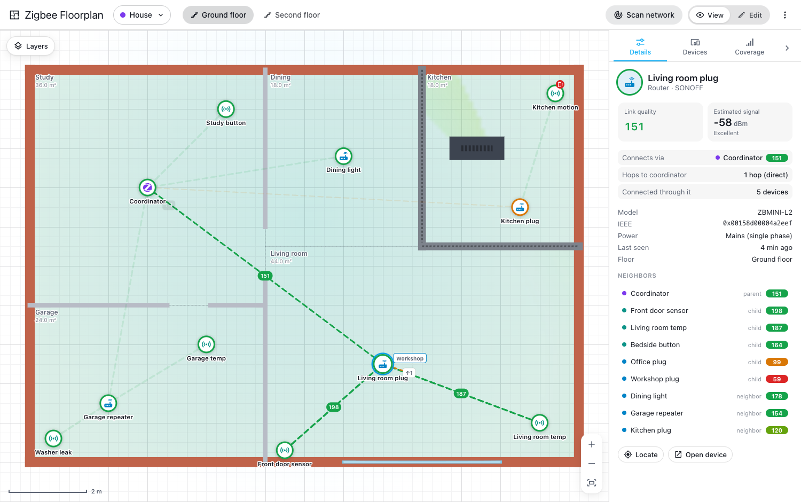
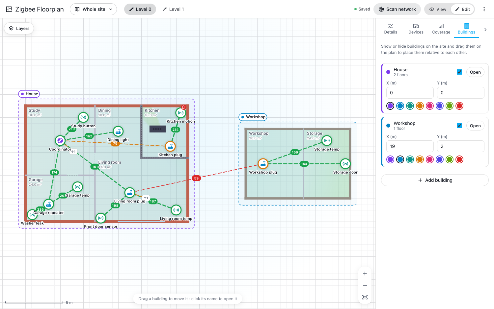
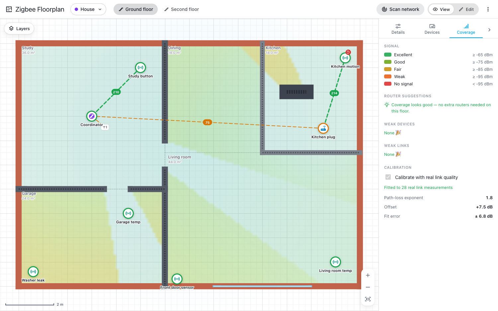

# Zigbee Floorplan para Home Assistant

[](https://github.com/NaturalDevCR/zigbee-floorplan/actions/workflows/ci.yml)
[](https://hacs.xyz)
[](LICENSE)

Dibuja tu casa en un plano, ubica tus dispositivos de **Zigbee2MQTT** y mira cómo se conecta realmente la red: quién enruta a través de quién, qué tan fuerte es cada enlace y dónde la señal se debilita.

[English](README.md)



## Características

- **Editor de planos.** Grid con ajuste, medidas en vivo, habitaciones, deshacer/rehacer y autoguardado. Calca sobre una foto o plano y fija su escala dibujando sobre una medida conocida.
- **Varios pisos y varios edificios.** Modela una casa, un taller, una oficina… cada uno con sus pisos. Abre un edificio por separado o **todo el sitio**, con edificios que puedes mostrar, ocultar y arrastrar a su posición.
- **Materiales de pared.** Drywall, madera, vidrio, vidrio Low‑E, ladrillo, bloque, concreto, concreto armado y metal, más la losa de cada nivel. Los valores de atenuación son editables.
- **La red real.** Enlaces del mapa de red de Zigbee2MQTT, coloreados por calidad (LQI), con la ruta de cada dispositivo hacia el coordinador, saltos, padres e hijos. Los dispositivos que faltan en el último escaneo quedan marcados.
- **Estimación de cobertura.** Un modelo RF multi‑pared dibuja un mapa de calor por piso, se calibra con el LQI que tus dispositivos reportan, lista dispositivos y enlaces débiles y **sugiere dónde agregar un router**.
- **Panel y tarjeta.** Un editor completo en la barra lateral y una tarjeta Lovelace para tus dashboards. Tema claro y oscuro, apto para móvil, en español e inglés.

| Todo el sitio | Cobertura y sugerencias |
|---|---|
|  |  |

## Requisitos

- Home Assistant **2026.10** o superior.
- La integración **MQTT**, con **Zigbee2MQTT** publicando en el mismo broker.

Zigbee Home Automation (ZHA) aún no está soportado; la fuente de datos está aislada para poder agregarlo después.

## Instalación

### HACS (recomendado)

[](https://my.home-assistant.io/redirect/hacs_repository/?owner=NaturalDevCR&repository=zigbee-floorplan&category=integration)

1. En HACS, menú ⋮ → **Repositorios personalizados**, agrega `https://github.com/NaturalDevCR/zigbee-floorplan` como **Integración**.
2. Descarga **Zigbee Floorplan** y reinicia Home Assistant.
3. **Ajustes → Dispositivos y servicios → Agregar integración → Zigbee Floorplan** e indica el `base_topic` de Zigbee2MQTT (normalmente `zigbee2mqtt`).

### Manual

Copia `custom_components/zigbee_floorplan` en `/config/custom_components/`, reinicia Home Assistant y agrega la integración como arriba.

## Inicio rápido

1. Abre **Zigbee Floorplan** en la barra lateral y pulsa **Crear el primer piso**.
2. Opcional: sube una imagen de tu plano (pestaña **Piso**) y usa **Fijar escala** sobre una medida conocida.
3. Dibuja paredes (`W`) eligiendo el material y marca habitaciones (`R`) para que la cobertura se calcule dentro de ellas.
4. En **Dispositivos**, arrastra cada dispositivo al plano.
5. Pulsa **Escanear red** para leer los enlaces reales. Luego abre **Cobertura** para ver zonas débiles y sugerencias de routers.

Solo los administradores pueden editar; los demás usuarios ven el plano en modo lectura.

### Edificios y sitio

- El selector junto al título cambia entre **Todo el sitio** y cada edificio, y permite **Agregar edificio**.
- En un edificio, las pestañas son sus pisos; ahí se dibujan paredes, habitaciones y dispositivos.
- En **Todo el sitio**, las pestañas son niveles (0, 1, 2…) y se muestra ese piso de cada edificio visible. En modo Editar, arrastra un edificio para posicionarlo y haz clic en su nombre para abrirlo. La pestaña **Edificios** permite ocultar o mostrar, ajustar la posición y el color.
- La cobertura entre edificios suma las paredes exteriores de ambos; las losas solo cuentan dentro del mismo edificio.

### Atajos de teclado

| Tecla | Acción |
|---|---|
| V / W / R / M / C / H | Seleccionar / Paredes / Habitaciones / Medir / Escalar imagen / Mover |
| Shift (mientras dibujas) | Desactiva el ajuste |
| Enter · Esc · doble clic | Termina la pared o habitación |
| Supr / Retroceso | Elimina la selección (los dispositivos se quitan del plano) |
| Flechas (+Shift) | Desplaza la selección un paso de grid (×10) |
| Ctrl/Cmd+D | Duplica paredes seleccionadas |
| Ctrl/Cmd+Z · Ctrl/Cmd+Shift+Z | Deshacer · Rehacer |
| F · + · − · Espacio+arrastrar | Ajustar vista · Zoom · Mover vista |

## Tarjeta Lovelace

```yaml
type: custom:zigbee-floorplan-card
title: Red Zigbee
building: site        # opcional: "site" o el id de un edificio
height: 420
links: tree           # tree (rutas) | all (todos los vecinos)
layers: [heatmap, links, labels, background]
```

Tiene editor visual. Más opciones en [docs/lovelace-card.md](docs/lovelace-card.md) (en inglés).

## Cómo se estima la cobertura

Modelo multi‑pared (estilo COST 231):

```
RSSI = Tx − PL0 − 10·n·log10(d) − Σ paredes cruzadas (dB) − Σ losas cruzadas (dB)
```

Valores iniciales: PL0 = 40 dB a 1 m (2.4 GHz), n = 2.2, Tx 5 dBm (coordinador y routers) y 3 dBm (dispositivos finales). Con al menos 3 mediciones reales entre dispositivos ubicados se ajustan `n` y un offset. La conversión LQI→RSSI es aproximada y depende del chip: el mapa sirve para comparar ubicaciones, no es una medición. Detalle en [docs/coverage-model.md](docs/coverage-model.md).

## Tus datos

- El plano se guarda en `/config/.storage/zigbee_floorplan.project` y el último escaneo de red en `/config/.storage/zigbee_floorplan.network`.
- Las imágenes de fondo están en `/config/zigbee_floorplan/images/` (PNG, JPEG o WebP, hasta 15 MB) y solo se sirven a usuarios con sesión.
- Nada sale de tu Home Assistant. Exporta o importa el plano en JSON desde el menú ⋮ del panel.

## Documentación

Las guías están en inglés: [instalación](docs/installation.md), [uso](docs/usage.md), [modelo de cobertura](docs/coverage-model.md), [tarjeta](docs/lovelace-card.md), [problemas comunes](docs/troubleshooting.md), [arquitectura](docs/architecture.md) y [desarrollo](docs/development.md).

## Contribuir

Issues y pull requests son bienvenidos. Mira [CONTRIBUTING.md](CONTRIBUTING.md).

## Licencia

[MIT](LICENSE)
