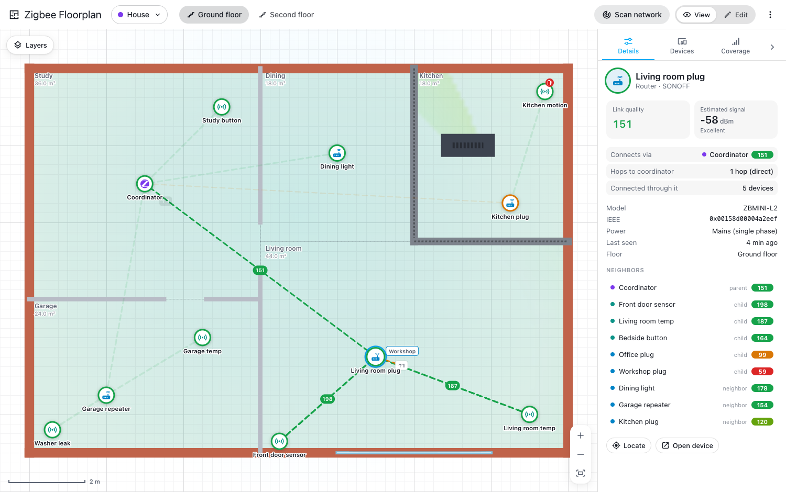
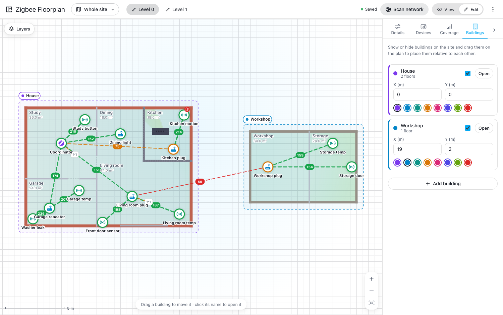
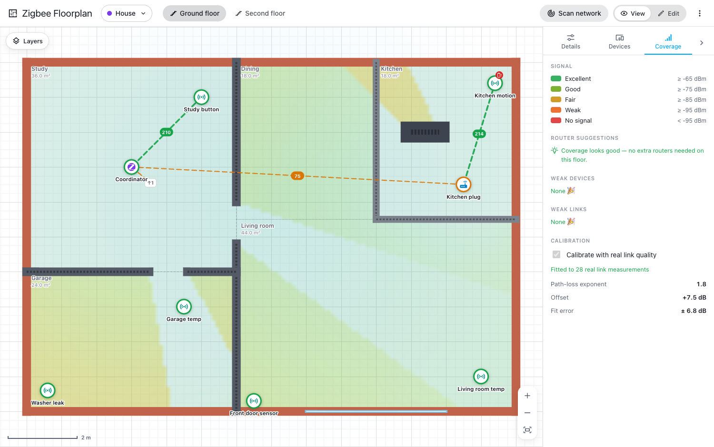
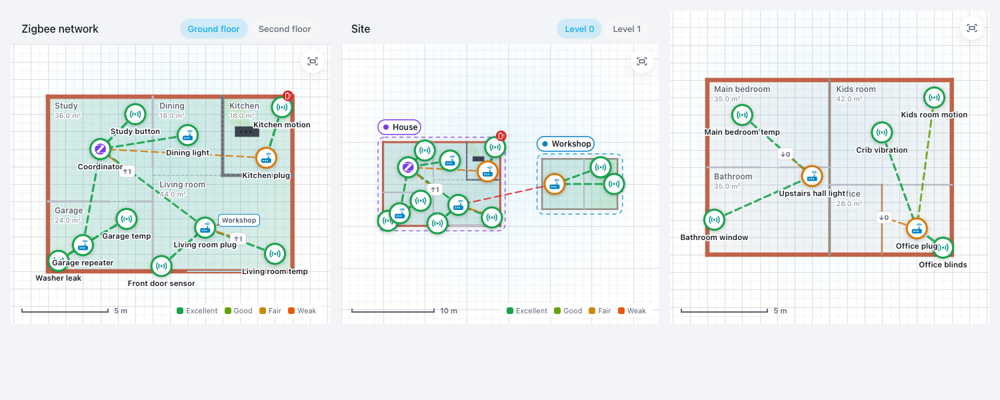

# Zigbee Floorplan for Home Assistant

[](https://github.com/NaturalDevCR/zigbee-floorplan/actions/workflows/ci.yml)
[](https://hacs.xyz)
[](LICENSE)

Draw your home on a floor plan, drop your **Zigbee2MQTT** devices on it and see how the mesh really connects: who routes through whom, how strong each link is, and where the signal gets weak.

[Español](README.es.md)



## Features

- **Floor plan editor.** Grid with snapping, live measurements, rooms, undo/redo and autosave. Trace over a photo or blueprint and set its scale by drawing over a known length.
- **Several floors and several buildings.** Model a house, a workshop, an office… each with its own floors. Open one building at a time, or the **whole site** with buildings you can show, hide and drag into place.
- **Wall materials.** Drywall, wood, glass, low‑E glass, brick, block, concrete, reinforced concrete and metal, plus the floor slab of every level. Attenuation values are editable.
- **The real mesh.** Links from the Zigbee2MQTT network map, colored by link quality (LQI), with the route of every device to the coordinator, hop counts, parents and children. Devices missing from the last scan are flagged.
- **Coverage estimate.** A multi‑wall RF model draws a heatmap per floor, calibrates itself with the LQI your devices actually report, lists weak devices and links, and **suggests where to add a router**.
- **Panel and card.** A full editor in the sidebar and a Lovelace card for your dashboards. Light and dark themes, phone friendly, English and Spanish.

| Whole site | Coverage and suggestions |
|---|---|
|  |  |

## Requirements

- Home Assistant **2026.10** or newer.
- The **MQTT** integration, with **Zigbee2MQTT** publishing to the same broker.

Zigbee Home Automation (ZHA) is not supported yet; the data source is isolated so it can be added later.

## Installation

### HACS (recommended)

[](https://my.home-assistant.io/redirect/hacs_repository/?owner=NaturalDevCR&repository=zigbee-floorplan&category=integration)

1. In HACS, open the menu ⋮ → **Custom repositories**, add `https://github.com/NaturalDevCR/zigbee-floorplan` as an **Integration**.
2. Download **Zigbee Floorplan** and restart Home Assistant.
3. **Settings → Devices & services → Add integration → Zigbee Floorplan**, and enter your Zigbee2MQTT `base_topic` (usually `zigbee2mqtt`).

### Manual

Copy `custom_components/zigbee_floorplan` into your `/config/custom_components/` folder, restart Home Assistant and add the integration as above.

More detail in [docs/installation.md](docs/installation.md).

## Quick start

1. Open **Zigbee Floorplan** in the sidebar and press **Create first floor**.
2. Optionally upload an image of your plan (**Floor** tab) and use **Set scale** over a length you know.
3. Draw walls (`W`) choosing a material, and mark rooms (`R`) so coverage is computed inside them.
4. From **Devices**, drag each device onto the plan.
5. Press **Scan network** to read the real links. Then open **Coverage** for weak spots and router suggestions.

Only administrators can edit; everyone else gets a read‑only view. The full guide is in [docs/usage.md](docs/usage.md).

## Lovelace card

```yaml
type: custom:zigbee-floorplan-card
title: Zigbee network
building: site        # optional: "site" or a building id
height: 420
links: tree           # tree (routes) | all (every neighbour)
layers: [heatmap, links, labels, background]
```

The card has a visual editor. See [docs/lovelace-card.md](docs/lovelace-card.md).



## Documentation

| | |
|---|---|
| [Installation](docs/installation.md) | HACS, manual install, options, upgrading |
| [Using the editor](docs/usage.md) | Drawing, devices, buildings, shortcuts |
| [Coverage model](docs/coverage-model.md) | How signal is estimated and calibrated |
| [Lovelace card](docs/lovelace-card.md) | Card options |
| [Troubleshooting](docs/troubleshooting.md) | Common problems |
| [Architecture](docs/architecture.md) | How it is built |
| [Development](docs/development.md) | Running tests, building, contributing |

## Your data

- The plan is stored in `/config/.storage/zigbee_floorplan.project` and the last network scan in `/config/.storage/zigbee_floorplan.network`.
- Background images live in `/config/zigbee_floorplan/images/` (PNG, JPEG or WebP, up to 15 MB) and are only served to signed‑in users.
- Nothing leaves your Home Assistant. Use the ⋮ menu in the panel to export or import the plan as JSON.

## Contributing

Issues and pull requests are welcome. See [CONTRIBUTING.md](CONTRIBUTING.md).

## License

[MIT](LICENSE)
