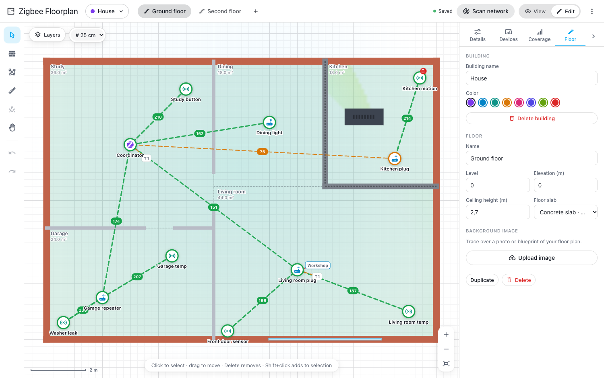
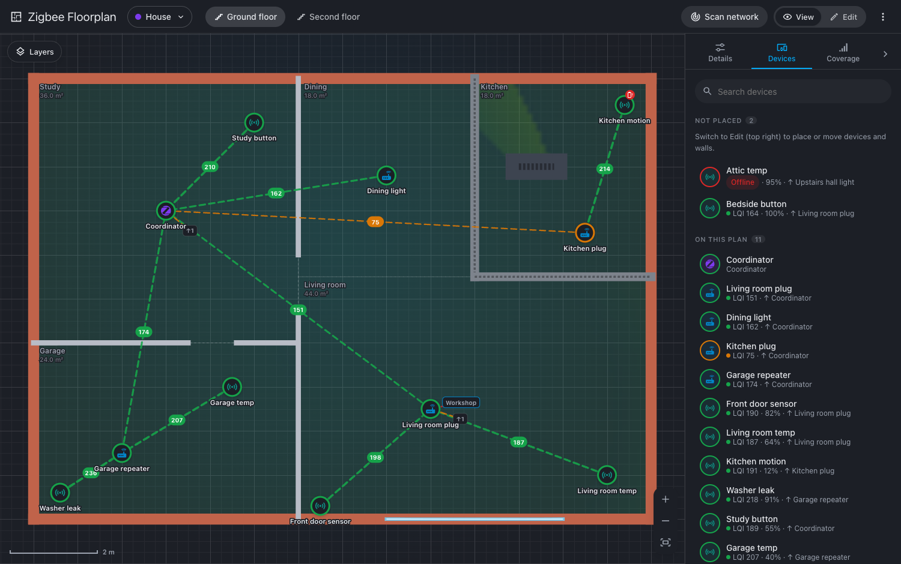

# Using the editor

Open **Zigbee Floorplan** in the sidebar. The top bar has the **building switcher**, the **floor tabs**, **Scan network**, the **View / Edit** switch and a ⋮ menu to export or import the plan.

## Floors and buildings

A plan is made of **buildings** (a house, a workshop, an office…) and every building has one or more **floors**.

- The switcher next to the title chooses **Whole site** or a single building, and adds buildings.
- Inside a building the tabs are its floors. Use **+** to add one; the **Floor** tab sets its name, level, elevation, ceiling height and slab material, and can duplicate or delete it.
- In **Whole site** the tabs are *levels* (0, 1, 2…) and each visible building shows its floor at that level. In **Edit** mode drag a building to position it relative to the others, and click its name to open it. The **Buildings** tab hides or shows buildings and sets their position and color.

Plans made before buildings existed are moved into a building called "Building 1" the first time you open them.

## Drawing

Switch to **Edit**. The tools on the left (shortcut in brackets):

| Tool | What it does |
|---|---|
| Select (V) | Click or drag a box to select. Drag to move. Selected walls and rooms show handles on their corners. |
| Walls (W) | Click to add points, double‑click, Enter or Esc to finish. Pick material, thickness and grid size from the options at the top. |
| Rooms (R) | Click each corner; click the first point or press Enter to close. Rooms define where coverage is computed. |
| Measure (M) | Click two points to see the distance. |
| Set scale (C) | Available when the floor has an image; see below. |
| Pan (H) | Drag to move the view. |

Snapping goes to existing corners, then walls, then 15° angles, then the grid. Hold **Shift** to disable it. Everything is autosaved; undo and redo are available for each edit.

### Background image

In the **Floor** tab upload a PNG, JPEG or WebP (up to 15 MB; large images are downscaled before upload). Then use **Set scale**: draw a line over a distance you know on the image and type its real length in meters. The image can be moved with the image tool, and its opacity and visibility are adjustable.

## Materials

Every wall has a material, and every floor has a slab material. Each one attenuates the radio signal by a number of dB (see [coverage model](coverage-model.md)). The values are editable in the project settings.

## Devices

The **Devices** tab lists everything Zigbee2MQTT reports.

- Drag a device onto the plan, or press **Place** and click the plan. In the site view a device lands in the building under the cursor.
- Placed devices show their health: green ring (healthy), amber (weak), red (offline), a battery badge when low, and a dashed ring with a **?** badge when the device is missing from the last network scan.
- Click a device for its detail: link quality, estimated signal, model, last seen, the device it **connects via**, **hops** to the coordinator, how many devices connect through it, and its neighbors labelled parent, child or neighbor. *Locate*, *Open device* (jumps to the Home Assistant device page) and *Remove from plan* are there too. Height above the floor and transmit power can be adjusted for the coverage model.

## The mesh

Press **Scan network** to ask Zigbee2MQTT for its network map. This briefly loads the mesh, and can take up to a minute.

- Links are colored and sized by link quality (LQI).
- The **Layers** menu has two link modes. **Routes** draws the route of every device towards the coordinator, with dashes flowing in the direction of the traffic. **All neighbors** draws every neighbor link found by the scan.
- Zigbee2MQTT labels parent and child only for end devices. For routers the panel infers each route: strong links and few hops win, and a router is never routed through an end device. This is an inference from the scan, not something Zigbee reports.
- Devices that are not in the last scan have no link data. A banner tells you how many; scan again to include them. Battery devices that sleep may not appear until they next talk to their router.
- A short stub with a floor or building name marks a link to a device that is not drawn in the current view.

## Coverage

The **Coverage** tab and the **Coverage** layer show the estimated signal. See [coverage model](coverage-model.md) for how it works. The tab also lists weak devices and weak links, and **router suggestions** (numbered on the plan; click one to center the view on it).

## Export and import

The ⋮ menu exports the plan to a JSON file and imports one (administrators only; the import replaces the current plan and can be undone).

## Keyboard shortcuts

| Key | Action |
|---|---|
| V · W · R · M · C · H | Select · Walls · Rooms · Measure · Set scale · Pan |
| Shift while drawing | Disable snapping |
| Enter · Esc · double‑click | Finish a wall or room |
| Delete / Backspace | Delete the selection (devices are removed from the plan) |
| Arrow keys (+Shift) | Nudge by one grid step (×10) |
| Ctrl/Cmd + D | Duplicate selected walls |
| Ctrl/Cmd + Z · Ctrl/Cmd + Shift + Z | Undo · Redo |
| F · + · − | Fit · Zoom in · Zoom out |
| Space + drag | Pan temporarily |

Your layer choices, link mode, drawing defaults, Edit mode and last view are remembered in this browser.
